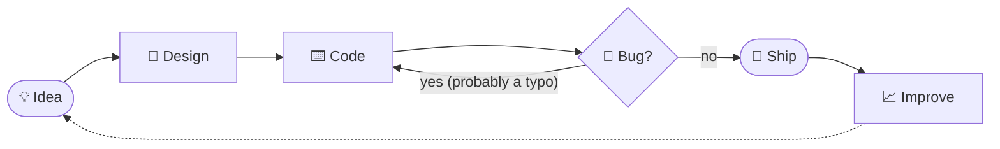

<!-- ======================= HEADER ======================= -->
<p align="center">
  
</p>

<p align="center">
  
</p>

<p align="center">
  
  
  
</p>

---

## 🖥️ Terminal: whoami

```bash
anh@dev:~$ whoami
Nhat Anh — Full-stack Developer

anh@dev:~$ cat now.txt
🔭 building   → full-stack web apps, tuning system performance
🌱 learning   → System Design, Cloud Architecture, Best Practices
👯 open to    → open-source & innovative web/mobile projects
💬 ask me     → Java · C# · JavaScript · Node.js · Web Dev

anh@dev:~$ fortune
"Spent 3 hours debugging. The bug was a typo." 😉

anh@dev:~$ _
```

---

## 🧭 How I Build Things



---

## 🛠️ Tech Arsenal

<div align="center">

**💻 Languages**<br/>


**🌐 Frontend**<br/>


**⚙️ Backend**<br/>


**🗄️ Database**<br/>


**☁️ Cloud, DevOps & Tools**<br/>


</div>

---

## 🚀 Project Showcase

<!--
  TODO: replace the placeholder text with your real repositories.
  Each <details> block is collapsible, so the page stays tidy.
-->

<details open>
<summary><b>⭐ Project 1 — Your project name</b></summary>
<br/>

> One sentence describing what it does and the problem it solves.


🔗 [Repository](https://github.com/anhnnse69/REPO_NAME)

</details>

<details>
<summary><b>⭐ Project 2 — Your project name</b></summary>
<br/>

> One sentence describing what it does and the problem it solves.


🔗 [Repository](https://github.com/anhnnse69/REPO_NAME)

</details>

<details>
<summary><b>⭐ Project 3 — Your project name</b></summary>
<br/>

> One sentence describing what it does and the problem it solves.


🔗 [Repository](https://github.com/anhnnse69/REPO_NAME)

</details>

---

## 🎯 Currently Levelling Up

<div align="center">


-Exploring-0078D4?style=for-the-badge&labelColor=0f0c29)


</div>

---

## 📊 GitHub Activity

<p align="center">
  
</p>

<p align="center">
  
</p>

---

## 🎲 Random Dev Facts

<details>
<summary><b>Click to reveal 👀</b></summary>
<br/>

- 🐛 The best debugger is a short walk and a glass of water.
- ⌨️ I believe every project deserves a good README.
- 🧠 If the code needs a comment to explain it, I try rewriting the code first.
- ☕ Bugs are just features that haven't been documented yet.

</details>

---

## 🤝 Let's Connect

<p align="center">
  <a href="https://github.com/anhnnse69"></a>
  <a href="https://www.linkedin.com/in/YOUR_LINKEDIN"></a>
  <a href="mailto:YOUR_EMAIL@example.com"></a>
</p>

<p align="center">
  <i>Thanks for stopping by. Happy coding! 🚀</i>
</p>

<p align="center">
  
</p>
